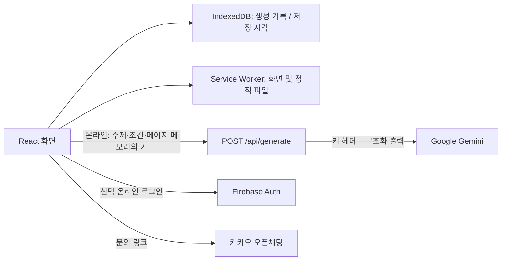

# 아이디어 노트

무규규 팀 자료를 바탕으로 구현한 한국어 아이디어 도우미입니다. **주제·조건 입력 → 생성 → 재생성/조건 수정 → 선택 저장 → 목록·상세 재조회**를 제공합니다. 카테고리는 자료에서 미정이었으므로 `프로젝트 아이디어` 하나로 구현했습니다.

## 원안에서 달라진 점

사용자의 최신 요청에 따라 로컬 모델 대신 **Gemini API의 `gemini-2.5-flash-lite`**를 연결했습니다. Gemini는 다운로드해서 오프라인으로 실행하는 모델이 아닙니다. 생성할 때 입력 주제·조건이 이 앱의 중계 API를 거쳐 Google로 전송됩니다. 원안의 **오프라인 생성 및 외부 AI 서버 전송 금지 요구는 이 버전에 적용되지 않습니다.** 생성에는 인터넷이 필요하고, 기기 내 저장·기록 조회는 오프라인으로 가능합니다.

자료 안의 역할·일정·AI 활용 규칙은 제품 설계 참고 자료로 읽었으며, 외부 계정 생성이나 팀원 승인 완료의 증거로 취급하지 않았습니다. 바탕화면의 원본 README는 수정하지 않았습니다.

## 실행

Node.js **22.13 이상**과 npm이 필요합니다. 검증 환경은 Windows / Node 24.19입니다.

```powershell
cd "C:\Users\wizju\Desktop\아이디어 노트"
npm.cmd run install:ci
npm.cmd run dev
```

개발 화면: **http://127.0.0.1:5173**

GitHub에서 새로 내려받는 경우에는 다음 명령으로 준비한 뒤 위의 설치·실행 명령을 사용하세요.

```powershell
git clone https://github.com/jungjae0821/idea-note.git
cd idea-note
npm.cmd run install:ci
npm.cmd run dev
```

비공개 저장소이므로 접근 권한이 있는 GitHub 계정으로 로그인해야 합니다. 폴더 위치가 다르면 `cd` 경로를 해당 위치로 바꾸세요.

이 환경에서 npm 실행 경로 오류가 나면 아래처럼 Node에 npm의 실제 진입 파일을 전달할 수 있습니다. 다른 PC에서는 설치 위치에 맞게 바꾸세요.

```powershell
node "C:\Program Files\nodejs\node_modules\npm\bin\npm-cli.js" run install:ci
node "C:\Program Files\nodejs\node_modules\npm\bin\npm-cli.js" run dev
```

오프라인 조회를 검증하려면 **빌드 실행**을 사용하세요. 실행 중인 빌드 서버를 먼저 Ctrl+C로 종료한 뒤 다시 빌드해야 Windows 파일 잠금 오류를 피할 수 있습니다.

```powershell
npm.cmd run typecheck
npm.cmd test
npm.cmd run build
npm.cmd start -- --port 8787
```

빌드 실행: **http://127.0.0.1:8787**. 서비스 워커는 빌드 실행과 HTTPS 배포에서 동작합니다. 개발 중에는 캐시가 최신 소스를 가리는 문제를 막기 위해 새로 등록하지 않습니다. 저장소는 주소/포트/브라우저별로 달라지므로 개발 화면과 빌드 화면 사이에 기록이 이동하지 않습니다.

## Gemini 연결

1. [Google AI Studio](https://aistudio.google.com/apikey)에서 API 키를 발급합니다.
2. 무료 사용을 원하면 **결제가 연결되지 않은 무료 프로젝트**의 키를 사용합니다.
3. 앱의 `준비 · 설정 → Gemini API 키`에 키를 입력하고 `키 연결하기`를 누릅니다.
4. `아이디어 만들기`에서 주제와 선택 조건을 입력하고 생성합니다.

키는 현재 페이지의 React 메모리에만 보관됩니다. 소스, 로컬 저장소, 세션 저장소, 생성 기록에 기록하지 않습니다. 새로고침하면 키를 다시 입력해야 합니다. 키는 생성 요청의 헤더로 이 앱의 서버에 전달되고, 서버가 Google API에 전달합니다. 서버는 요청/키/아이디어 본문을 로그나 DB에 저장하지 않으며, 서비스 워커도 POST/API 응답을 캐시하지 않습니다. 운영 시 별도의 프록시 로그 정책은 운영자가 확인해야 합니다.

입력한 키의 유효성은 실제 생성 요청으로 확인합니다. 준비 화면의 `키 입력됨`은 인증 검증 완료를 의미하지 않습니다. 서버에 공용 키를 넣지 않으므로 여러 사용자가 같은 무료 한도를 공유하지 않습니다.

Google 공식 가격표에서 이 모델의 일반 API 입력·출력은 무료 등급을 지원합니다. **무료 여부는 모델명만으로 보장되지 않습니다.** 프로젝트 등급·지역·사용 한도·정책에 따라 달라지며, 결제가 연결된 프로젝트는 요금이 발생할 수 있습니다. 자동 재시도, 유료 모델 자동 대체, 검색 그라운딩, 배치 API는 사용하지 않습니다. 429 응답이면 한도 안내를 표시하고 사용자가 직접 재시도합니다. 무료 등급 콘텐츠는 Google의 서비스 개선에 사용될 수 있습니다.

공식 자료: [가격](https://ai.google.dev/gemini-api/docs/pricing#gemini-2.5-flash-lite), [키 발급](https://ai.google.dev/gemini-api/docs/api-key), [구조화 출력](https://ai.google.dev/gemini-api/docs/structured-output), [사용 한도](https://ai.google.dev/gemini-api/docs/rate-limits). 2026-10-14 확인.

## 선택 기능 설정

### 구글 로그인

Firebase Authentication의 Google 로그인을 구현했습니다. 사용할 **팀 Firebase 프로젝트 설정이 필요**하며, 설정하지 않아도 핵심 기능은 작동합니다.

1. Firebase 콘솔에서 웹 앱을 등록하고 Authentication → Sign-in method → Google을 활성화합니다.
2. Authentication → Settings → Authorized domains에 실제 접속 도메인을 추가합니다. 로컬 검증은 `127.0.0.1` 또는 `localhost`, 배포는 반환된 실제 호스트를 승인합니다.
3. 앱의 `준비 · 설정 → 팀 Firebase 프로젝트 연결`을 펼치고 공개 웹 앱 설정을 **유효한 JSON**으로 붙여넣습니다.

```json
{
  "apiKey": "YOUR_FIREBASE_WEB_API_KEY",
  "authDomain": "YOUR_PROJECT.firebaseapp.com",
  "projectId": "YOUR_PROJECT",
  "appId": "YOUR_APP_ID"
}
```

Firebase 웹 설정의 apiKey는 Gemini 비밀 키와 다른 값입니다. 서비스 계정 키/비공개 키는 입력하지 마세요. Firebase 웹 설정은 로그인 성공 시 이 브라우저에 저장합니다. Firebase SDK는 Google 공식 CDN에서 로그인 시에만 불러오고, 팝업 로그인 및 메모리 세션을 사용합니다. 새로고침하면 다시 로그인합니다. 로그인 실패는 생성·저장·기록 조회를 차단하지 않습니다. 계정을 바꿔도 기록은 계정별로 분리되지 않으며 자동 동기화되지 않습니다. 설정을 다른 프로젝트로 바꿀 때는 새로고침 후 로그인하세요.

[공식 Firebase Google 로그인 문서](https://firebase.google.com/docs/auth/web/google-signin)

### 카카오톡 문의

실제 문의 주소가 자료에 없어 임의 주소를 만들지 않았습니다. `준비 · 설정 → 팀 오픈채팅 주소 설정`에 `https://open.kakao.com/o/...` 형식의 팀 주소를 저장하면 문의 링크가 열립니다. 이 값은 이 브라우저에 보관합니다. 인증/문의 요청에는 아이디어 주제·조건·본문을 포함하지 않습니다.

## 구현 구조

| 영역 | 기술 | 역할 |
| --- | --- | --- |
| 화면 | TypeScript, React 19, Vinext/Vite | 모바일·데스크톱 반응형, 화면 S01–S07 |
| AI 중계 | TypeScript HTTP route, Web Fetch API | 입력 검증, Gemini 호출, 오류 표준화; 키·본문 저장 없음 |
| 모델 | Gemini 2.5 Flash-Lite | 한국어 프로젝트 아이디어 한 개; JSON 구조화 출력 |
| 기기 저장 | IndexedDB | 성공 기록·저장 시각; 트랜잭션 완료 후 저장 완료 표시 |
| 오프라인 조회 | Service Worker, Cache API | 화면/동일 출처 정적 파일 보관; API·인증은 캐시 제외 |
| 선택 로그인 | Firebase Auth | 온라인 구글 로그인·로그아웃; 기록과 분리 |
| 빌드/배포 | Sites 호환 Cloudflare Worker | 로컬 실행과 비공개 Sites 배포용 산출물 |



로그인/문의 경로에는 아이디어 본문을 보내지 않습니다. 서버 DB와 계정별 저장은 없습니다. Sites 비공개 배포의 플랫폼 접근 로그인은 Firebase의 선택 계정 연동과 별개입니다. 플랫폼 접근 인증이 만료되면 온라인 재인증이 필요할 수 있습니다.

### 파일

```text
app/page.tsx                 홈·입력·결과·저장·기록·상세·설정
app/globals.css              반응형 화면 스타일
app/api/generate/route.ts    생성 HTTP API
lib/idea.ts                  입력/결과 검증, Gemini 어댑터, 데이터 타입
lib/storage.ts               기기 기록/저장 트랜잭션
public/sw.js                 오프라인 화면 캐시
tests/core.test.mjs          핵심 로직 테스트 (외부 API 대역)
docs/ACCEPTANCE.md           요구사항 대응·발표 검증 체크리스트
docs/VERIFICATION.md         이번 구현의 검증 결과와 미확인 범위
.openai/hosting.json         배포 식별자·구성; 비밀 키 없음
```

### 데이터

원안 필드를 유지합니다: `id`, `categoryId`, `topic`, `constraints`, `title`, `body`, `createdAt`, `savedAt`, `modelId`. 생성 성공 시 저장소에 기록하고, 사용자가 저장하면 **같은 기록의 `savedAt`만 추가**합니다. 중복 저장 시 기존 시각을 유지합니다. 생성·재생성마다 새 ID를 만들며 과거 기록을 덮어쓰지 않습니다. 날짜는 UTC ISO 문자열로 저장하고 화면에서는 사용 기기의 시간대로 표시합니다.

`listHistory()`는 최신 생성순, 저장 화면은 `savedAt`이 있는 기록만 최신 저장순으로 표시합니다. 제목이 비어 있으면 주제를 사용합니다. 빈 본문·차단·잘린 출력·오류는 성공 기록으로 남기지 않습니다. 저장 실패 시 결과와 입력을 화면에 유지하고 기록 저장/결과 저장 재시도를 제공합니다.

### API

`POST /api/generate`

헤더: `Content-Type: application/json`, `x-gemini-key: <현재 페이지의 키>`

```json
{"categoryId":"project","topic":"대학생의 자투리 시간을 활용하는 앱","constraints":"2명, 4주"}
```

성공: `200 {"record": {...}}`. 실패: `{"error":"코드","message":"사용자 안내"}`.

| 코드 | 의미 |
| --- | --- |
| INVALID_INPUT | 주제 공백, 길이 초과, 잘못된 카테고리/JSON |
| MODEL_NOT_READY | 키 미입력 |
| INVALID_KEY | Google이 입력/키/권한을 거절 |
| RATE_LIMITED | Google 한도 초과, HTTP 429 |
| MODEL_UNAVAILABLE | 연결 실패 또는 60초 제한 |
| EMPTY_RESULT | 차단·빈 결과·불완전한 JSON/출력 |
| GENERATION_FAILED | 기타 생성 오류 |

입력 제한: 주제 200자, 조건 1,500자, 요청 본문 12,000자. UI에서는 즉시 잠금으로 같은 페이지에서 한 번에 하나의 생성만 실행합니다. 생성 중 화면 이동 버튼을 비활성화하고 새로고침/닫기에는 브라우저 확인을 요청합니다. 서버 간/여러 탭 간 전역 요청 잠금은 제공하지 않습니다.

## 확인해야 할 부분

- **실제 Gemini 키로 생성 1회 + 재생성 4회**를 연속 실행하고 응답 시간·품질·한도를 기록하세요.
- 다른 아이디어 **6개를 저장**, 성공 기록 **8건을 생성**하고 재실행 후 제목·조건·본문·시각을 비교하세요.
- 빌드 화면의 `오프라인 조회 준비 완료`를 확인한 뒤 네트워크를 끄고 새로고침해 저장·기록·상세를 확인하세요. 최초 접속, 캐시 삭제 직후, 인증 만료 상태에서는 온라인 접속이 필요할 수 있습니다.
- Firebase 실제 프로젝트로 로그인·취소·실패·로그아웃을 확인하세요.
- 브라우저 저장 공간 부족/비공개 모드/저장 차단에서 실패 안내와 현재 결과 유지를 확인하세요.
- 실제 발표 기기에서 화면 크기, 메모리, 5회 연속 사용 안정성과 응답 시간을 측정하세요. 이 구현은 로컬 모델 성능 검증을 대신하지 않습니다.

브라우저 데이터 삭제, 브라우저의 저장소 자동 정리, 기기 변경에는 데이터 유지가 보장되지 않습니다. 내보내기·자동 백업·동기화·공유·여러 카테고리·사진 입력·모델 학습은 구현 범위에서 제외했습니다.
